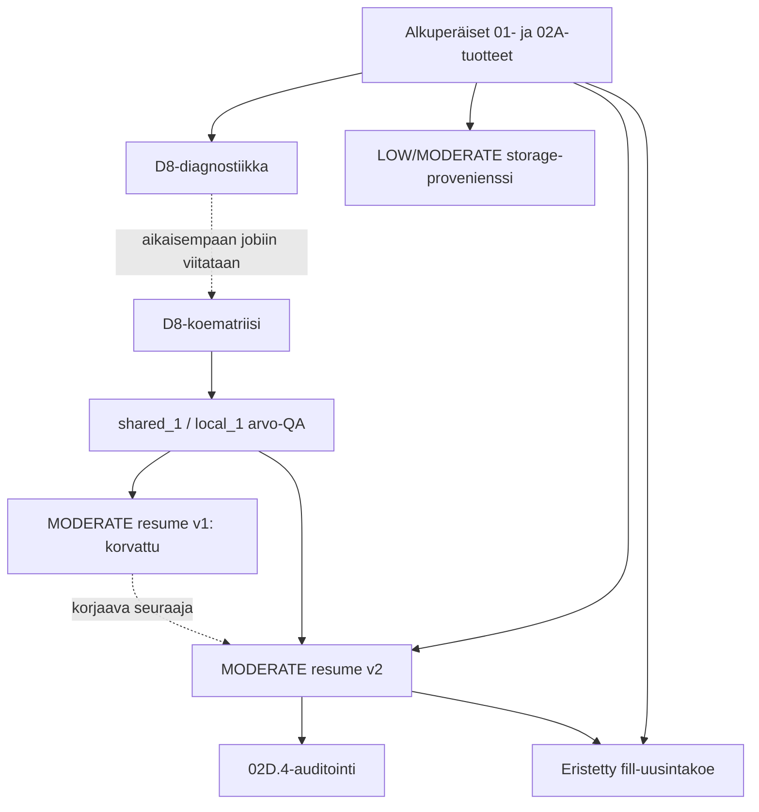

# CSC Roihu: kehitysvaihe 14.10.2026

Tämä arkisto säilyttää kahdeksan CSC Roihussa kehitettyä ja käyttäjän mukaan
14.10.2026 käytettyä skriptiä. Ne ovat GitHubin aikaisempaa hydrologiatestiversiota
seuraavan CSC-työvaiheen aineistoa. Skriptien siirtäminen versionhallintaan ei ole
uusi hydrologia-ajo eikä niiden menetelmien hyväksyntä kanoniseen lähdekoodiin.

Vertailu ja arkistointi tehtiin 15.10.2026 vain repositoriossa
`annasuuronen/MaaltaMerelle` (GitHub ID `1407101587`) ja haarassa
`baseline-no-structures`. Ennen arkistointia paikallinen ja GitHubin HEAD olivat
`4bbf22bb39181c8a4c27ebc3e2769766043115b8`. Seitsemän CSC-skriptiä tarkistaa
tämän commitin; 02D.4-auditointi lukee v2-tuotteita ilman omaa commit-tarkistusta.
Commit on lähtötilanne, ei koko CSC-kehitysvaihe.

## Alkuperäiset tiedostot

Kaikki [scripts/](scripts/) -tiedostot on kopioitu käyttäjän liitteistä
tavu tavulta muuttumattomina, myös ensimmäinen korvattu jatkoskripti.
Tiedostojen nykyiset latausajat eivät osoita niiden kehitys- tai ajoaikoja.
[scripts.tsv](scripts.tsv) sisältää koon, SHA256-tiivisteen ja arkistotilan.

Käyttäjän 15.10.2026 tarkennuksen mukaan kahdeksan alkuperäistä skriptiä on
ladattu suoraan CSC-hakemistoon `/scratch/project_2004707/pienvedet/`.
Erillistä skriptihakemistoa ei ollut vielä luotu. Käyttäjän suunnittelema
järjestelyhakemisto on `/scratch/project_2004707/pienvedet/csc_scripts_20261014/`;
siirtoa ei ole tässä vahvistettu tai tehty. Skriptien sisältämät
`csc_validation_4bbf22b`-polut ovat odotettuja laskenta- ja tulospolkuja,
joiden todellista olemassaoloa ei ole vielä tarkistettu Roihulta.

[SHA256SUMS](SHA256SUMS) tarkistaa nimenomaan arkistoitujen skriptien tavut:

```sh
cd docs/csc/2026-10-14
sha256sum -c SHA256SUMS
```

Tämä komento tarkistaa arkiston eheyttä; se ei aja CSC-skriptejä.
Skriptien `submit`-haarat sisältävät oikeita Slurm-lähetyksiä, rasterilaskentoja
ja jatkoajoja. Arkisto ei ole kehotus suorittaa niitä uudelleen. Kiinnitetty
CSC-checkout, moduuli `r-env/461`, `/projappl`- ja `/scratch`-polut sekä
`moderate_fill_recheck`-skriptin solmu `rc4129` ovat historiallista ajokontekstia.
Tämän arkistocommitin HEAD ei enää täytä skriptien vanhaa tarkkaa commit-ehtoa;
sitä ei muuteta, eikä niiden vuoksi pidä nollata nykyistä kehityshaaraa.

| Skripti | Tarkoitus | Asema kehityshistoriassa |
| --- | --- | --- |
| [maaltamerelle_roihu_d8_diagnostic.sh](scripts/maaltamerelle_roihu_d8_diagnostic.sh) | Aikaisempien välitulosten ja Slurm-tilan tarkastus; erillinen MODERATE D8Pointer -koe R-kääreen kautta. | Diagnostiikan lähtövaihe. |
| [maaltamerelle_roihu_d8_compare.sh](scripts/maaltamerelle_roihu_d8_compare.sh) | Suora Whitebox-ajotapa: `shared_1`, `shared_4` ja `local_1`; työntekijämäärän ja tallennuspaikan vertailu. | Viittaa aikaisempaan diagnostiseen jobiin; tuottaa arvovertailun syötteet. |
| [maaltamerelle_roihu_d8_value_qa.sh](scripts/maaltamerelle_roihu_d8_value_qa.sh) | `shared_1`- ja `local_1`-D8:n kaikkien 36 miljoonan solun arvovertailu ja koodijakauma. | Edellyttää kummankin kokeen metatietotarkistusta. |
| [maaltamerelle_roihu_resume_moderate.sh](scripts/maaltamerelle_roihu_resume_moderate.sh) | MODERATE-jatkoajo erilliseen hakemistoon olemassa olevilla 01/02A- ja D8-tuotteilla. | **Korvattu v2:lla. Säilytetään vain historiana.** D8-arvovertailun kohde ja `status`-funktion PASS-polku ovat virheellisiä. |
| [maaltamerelle_roihu_resume_moderate_v2.sh](scripts/maaltamerelle_roihu_resume_moderate_v2.sh) | Korjattu D8-muunnoksen arvo- ja maskitarkistus sekä eristetty jatkoajo. | V1:n seuraaja; ei automaattista tuotantokoodin korvausta. |
| [maaltamerelle_roihu_moderate_02d4_audit.sh](scripts/maaltamerelle_roihu_moderate_02d4_audit.sh) | Riippumaton korotettujen solujen laskenta ja vertailu MODERATE 02D.4 -taulukkoon. | Lukee v2-jatkoajon tuotteita. |
| [maaltamerelle_roihu_storage_provenance.sh](scripts/maaltamerelle_roihu_storage_provenance.sh) | LOW/MODERATE 02A -pintojen erot, alkuperätiedot ja rasterien SHA256:t lokiin. | Rinnakkainen alkuperäisten 02A-tuotteiden auditointi. |
| [maaltamerelle_roihu_moderate_fill_recheck.sh](scripts/maaltamerelle_roihu_moderate_fill_recheck.sh) | Alkuperäisen WATER_STORAGE-täytön eristetty uusintakoe samalla binäärillä, ilman `--fix_flats`-lippua, yhdellä työntekijällä. | Käyttää v2:n järviyhteenvetoa; vanha CSC-koe, jota ei ajeta tässä arkistoinnissa. |

## Riippuvuudet ja kehitysjärjestyksen rajat



Nuolet kuvaavat tiedostoista todettavia tuoteriippuvuuksia tai eksplisiittisiä
versioviitteitä, eivät todennettua Slurm-aikajanaa. Vertailu odottaa tarvittaessa
jobin `2285854` päättymistä (`afterany`, onnistumista ei vaadita).
Diagnostiikka viittaa myös historialliseen jobiin `2264131`. Numerot ovat
skriptiviitteitä; niiden todelliset tilat ja päivämäärät on tarkistettava lokeista.
Storage-auditoinnin, 02D.4-auditoinnin ja fill-kokeen keskinäistä kokonaisjärjestystä
ei voi varmistaa näistä liitteistä. Kumpikaan jälkimmäisistä ei lue toisen raporttia.

## Näyttö, lähdekoodivertailu ja seuraava vaihe

- [COMPARISON.md](COMPARISON.md): CSC-korjaukset, jo olemassa olevat menetelmät ja kanonisesta koodista puuttuvat QA-menettelyt.
- [EVIDENCE.md](EVIDENCE.md): käyttäjän ilmoittamat CSC-ajot, puuttuva ajonäyttö, pyydettävät pienet raportit ja PASS-merkintöjen täsmällinen tulkinta.
- [artifacts.tsv](artifacts.tsv): CSC-rasterien ja keskeisten raporttien sijainnit sekä tunnetut **skripteihin kirjatut odotetut** tiivisteet. Tyhjä tiiviste tarkoittaa, ettei sitä ole toimitettu.
- [ACTIONS.md](ACTIONS.md): dokumentointicommitin triggeritarkastus.

Tässä arkistoinnissa ei ole käytettävissä 14.10.2026 CSC Slurm-lokeja,
QA-CSV-tiedostoja tai `sacct`-raportteja. Käyttäjä ilmoittaa ajot suoritetuiksi;
yksittäistä CSC PASS-tulosta ei vielä vahvisteta. Aikaisemmat GitHub Actions
-tulokset ja pilviympäristön LOCAL_TEST-lokit ovat eri ajonäyttöä.
Alkuperäiset CSC- ja aiemmat GitHub-tulokset jäävät sijainteihinsa ja historiaan;
niitä ei ylikirjoiteta tai korvata tällä arkistolla.

Tieteelliset rajat säilyvät: ei perusteettomia purkupaikkoja, ei keksittyjä
D8-koodeja, ei rakenteiden tuomista baseline-reititykseen, ei virtaamajaon
oletuksia eikä NATIONAL-lukituksen avaamista. Nykyiset 02E/02F-tuotteet ovat
ehdokas- ja reittidiagnostiikkaa. Lopullinen purkautumisvalinta, lopullinen D8,
virtauskertymä, ruutusiirrot ja valtakunnallinen validointi ovat yhä kesken.
Seuraava työ on olemassa olevan CSC-näytön liittäminen ja tulosten arviointi;
uusia raskaita laskentoja tai näiden vaiheiden toteuttamista ei aloiteta tässä.
